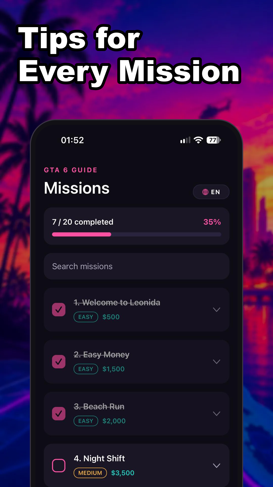
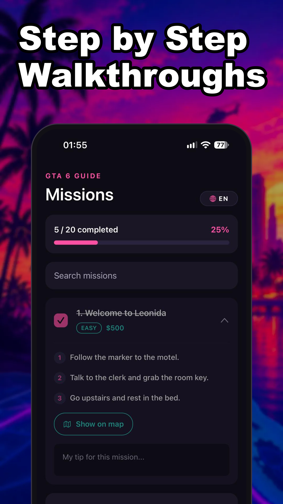
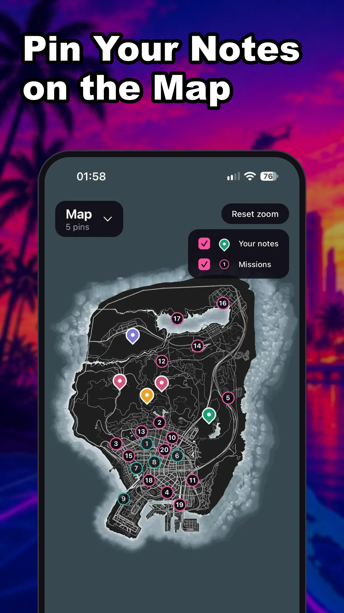
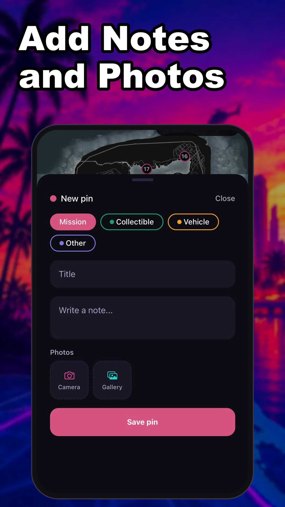

<p align="center">
  
</p>

<h1 align="center">GTA 6 Guidebook</h1>

<p align="center">
  An unofficial fan-made companion app for GTA 6: mission walkthroughs and a map you can pin and take notes on.
</p>

<p align="center">
  
  
  
  
</p>

> GTA 6 Guidebook is not affiliated with, endorsed by, or connected to Rockstar Games or
> Take-Two Interactive. All trademarks belong to their respective owners. The missions in the app
> are placeholders until the game is out.

## Features

**Missions**
- Step by step walkthroughs, difficulty and reward for every mission
- Tick missions off and track progress
- Personal tips per mission, mission search
- "Show on map" jumps straight to the mission on the map

**Map**
- Pinch to zoom, drag, double tap to zoom in
- Press and hold to drop a pin with a title, note, category and photos (camera or gallery)
- Every mission is marked on the map, notes and missions can be shown or hidden
- Pin list with search, the selected pin gets a short highlight ring

**General**
- Dark neon theme
- English, Türkçe, Español, Deutsch, Français (starts with the phone language)
- Works offline, all notes and photos stay on the device
- Google AdMob ads (banner, interstitial, native) and a one-time Premium purchase through RevenueCat that removes them

## Tech

- [Expo](https://expo.dev) SDK 58, React Native, TypeScript, [Expo Router](https://docs.expo.dev/router/introduction/)
- `react-native-gesture-handler` and `react-native-reanimated` for the map gestures
- `react-native-google-mobile-ads` for ads, `react-native-purchases` (RevenueCat) for Premium
- `@react-native-async-storage/async-storage` and `expo-file-system` for local data and photos

```
src/
  app/          screens (missions, map, premium)
  components/   UI pieces (mission card, pin sheet, ads, tab bar...)
  hooks/        pins, mission progress, premium state
  i18n/         translations for the UI and the missions
  data/         mission list
  ads/          AdMob setup and ad unit ids
docs/           privacy policy (GitHub Pages)
store/          Play Store texts, icon, feature graphic and screenshots
```

## Running it

```bash
npm install
npx expo start
```

The app opens in **Expo Go** with fake ads and a test mode Premium. Real ads and purchases need a
development build, since they use native code:

```bash
npx eas-cli@latest build --profile development --platform android
npx expo start --dev-client
```

Development builds always show Google's test ads. Real ad units are only used in release builds.

## Privacy

Privacy policy: https://alisamioglu.github.io/gta6-guidebook/privacy.html
